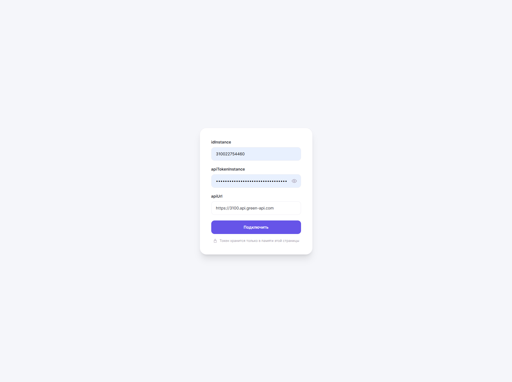
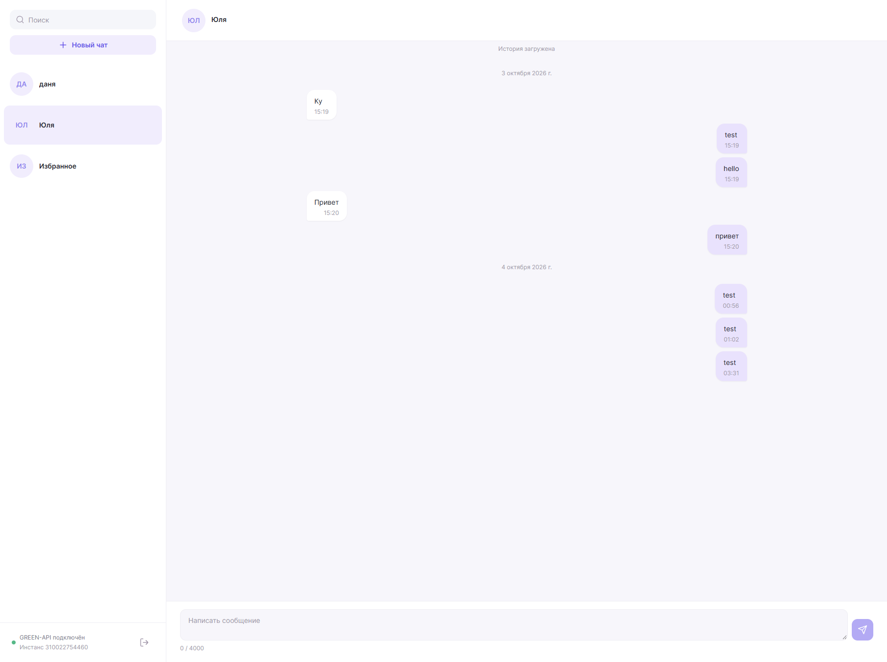
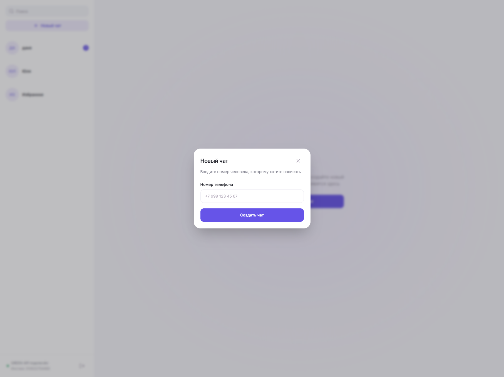
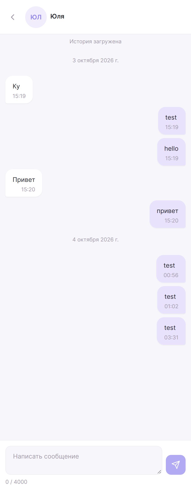

# MAX чат на GREEN-API

Тестовое задание на вакансию "Фронтенд разработчик React". Чат для отправки и получения текстовых сообщений в MAX через [GREEN-API](https://green-api.com/max).

Стек: React 19, TypeScript, Vite, Tailwind CSS.

## Запуск

Нужен Node.js 24 и yarn.

```bash
yarn install
yarn dev
```

Бэкенда и переменных окружения нет, данные инстанса вводятся в форме и сохраняются в состоянии страницы.

Сборка — `yarn build`, результат в `dist/`.

## Необходимые действия для работы

1. Создать инстанс MAX в [личном кабинете](https://console.green-api.com/) и авторизовать его.
2. В настройках включить "Получать уведомления о входящих сообщениях и файлах", поле Webhook URL оставить пустым.
3. Взять из кабинета `idInstance`, `apiTokenInstance` и `apiUrl`.

## Как проверить

1. Ввести данные инстанса и нажать "Подключить".
2. Нажать "Новый чат" и ввести номер получателя с кодом страны.
3. Написать сообщение. Enter отправляет, Shift + Enter переносит строку.
4. Ответить с телефона получателя в MAX — ответ появится в чате.

Инстанс лучше открывать в одной вкладке: уведомления лежат в общей очереди, и две вкладки будут забирать их друг у друга.

## Как устроено

Сообщения отправляются методом [SendMessage](https://green-api.com/v3/docs/api/sending/SendMessage/). Входящие приходят через [HTTP API](https://green-api.com/v3/docs/api/receiving/technology-http-api/): в цикле вызывается `ReceiveNotification`, уведомление обрабатывается и удаляется через `DeleteNotification`. Номер телефона переводится в `chatId` методом `CheckAccount`. Список чатов берётся из `GetChats`, история открытого чата — из `GetChatHistory`.

Данные инстанса хранятся только в памяти страницы, после перезагрузки нужно подключиться заново.

- `src/hooks/api` — клиент GREEN-API и обёртки над методами
- `src/providers` — состояние: авторизация, чаты, выбранный чат, получение уведомлений, открытая переписка
- `src/components` — компоненты
- `src/utils` — работа с номером, чатами и уведомлениями

## Скриншоты

| Вход                                  | Чат                                         |
| ------------------------------------- | ------------------------------------------- |
|                 |                        |
| **Новый чат**                         | **Мобильная версия**                        |
|  |  |
